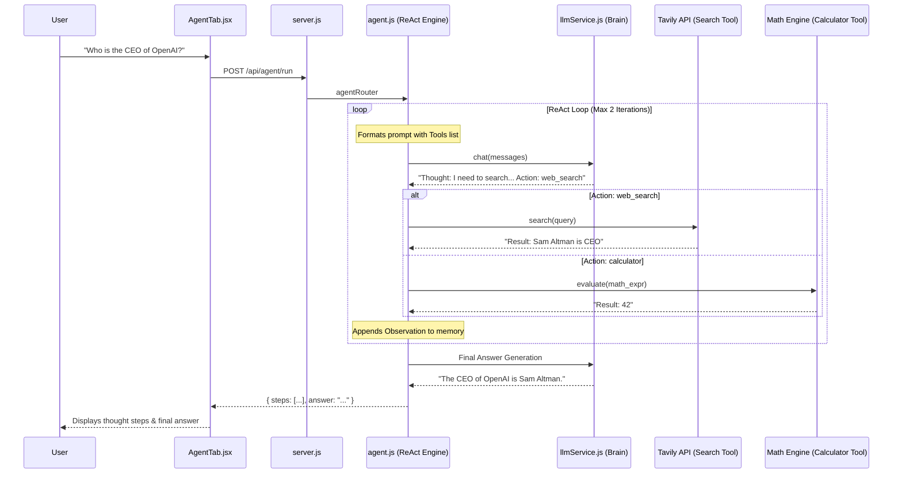

# AI Agent Architecture: ReAct Reasoning Loop

This diagram explains the "Thought-Action-Observation" loop that allows the Agent to use tools like Web Search and a Calculator.

### Key Components Explained:
1. **ReAct Logic**: The `agent.js` file manages the state. It tells the LLM: "Don't just answer, think first. If you need a tool, write `Action: [tool_name]`."
2. **`Tavily API`**: A specialized AI search engine that returns clean, parsed data from the internet instead of raw HTML.
3. **Reasoning Loop**: The agent loops until it has enough information or hits the `MAX_ITERATIONS` limit.
