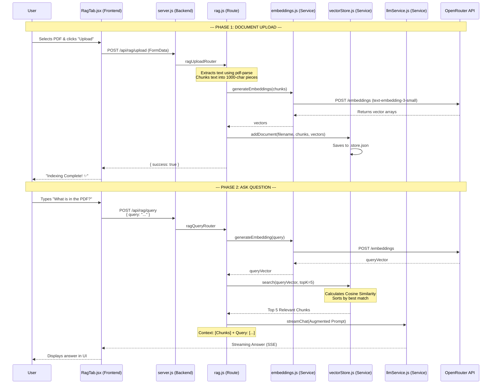

# RAG Architecture: Data Flow Diagram

Here is a visual representation of how the Retrieval-Augmented Generation (RAG) system processes document uploads and queries.

### Key Components Explained:
1. **`RagTab.jsx`**: Manages file selection, upload status, and the document-based chat UI.
2. **`embeddings.js`**: Converts human text into mathematical vectors (numbers) using OpenRouter's embedding model.
3. **`vectorStore.js`**: The "Brain". It stores chunks and vectors in a local JSON file and performs **Cosine Similarity** to find the most relevant document parts for your question.
4. **`pdf-parse`**: A backend library used to scrape raw text from PDF files before they are chunked.
