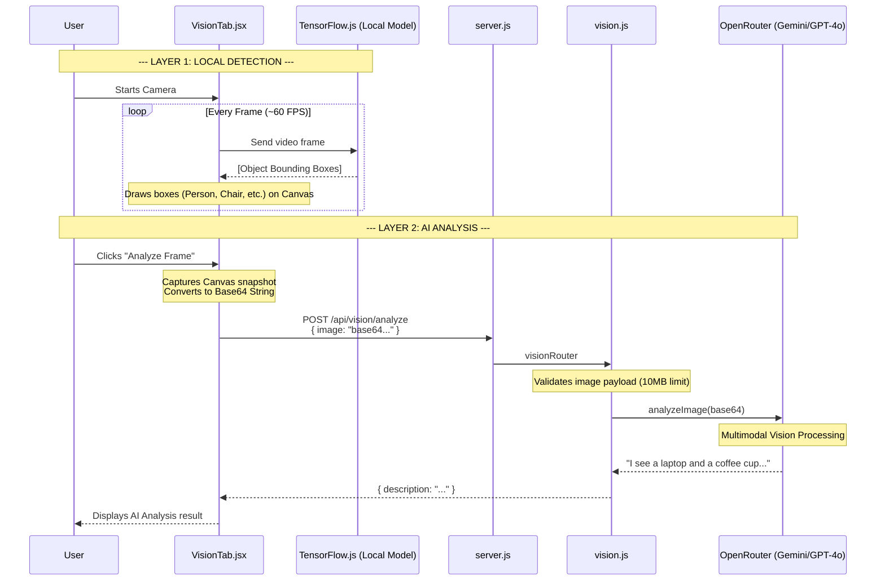

# Vision Architecture: Dual-Layer Analysis

This diagram shows how the app handles both real-time local detection and cloud-based AI analysis.

### Key Components Explained:
1. **`TensorFlow.js`**: Runs the `COCO-SSD` model directly in the browser. This ensures privacy because real-time video never leaves your computer.
2. **`COCO-SSD`**: A pre-trained model that can recognize 80 different common objects.
3. **Multimodal API**: When deep understanding is needed (like reading text or describing a scene), the app sends a single snapshot to **OpenRouter** (GPT-4o-mini).
