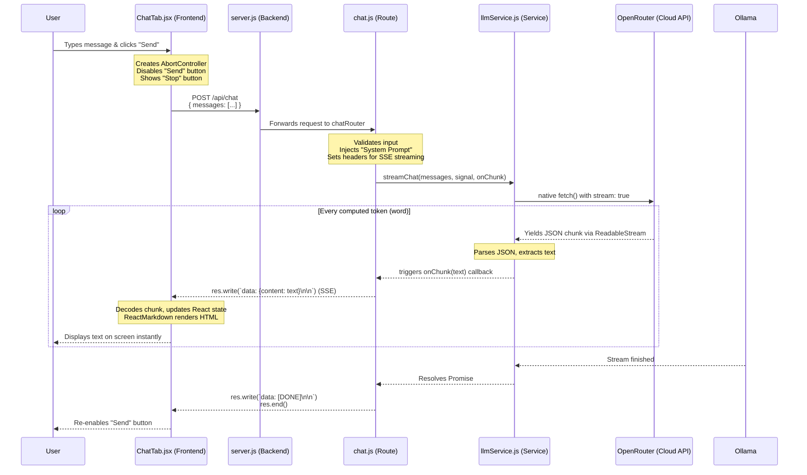

# Chat Architecture: Data Flow Diagram

Here is a visual representation of exactly how the different files in our application communicate when you type a message and press "Send".

### Key Components Explained:
1. **`ChatTab.jsx`**: The React UI. It listens to your keystrokes, initiates the HTTP request, and parses the streaming chunks back into beautiful HTML on your screen.
2. **`server.js`**: The Express "traffic cop". It intercepts `/api/chat` requests from the frontend and sends them to the correct route file.
3. **`chat.js`**: The route logic. It's responsible for the "System Prompt" injection and setting up the Server-Sent Events (SSE) connection so the browser knows to expect a continuous stream of data.
4. **`llmService.js`**: The native bridge. It makes the actual `fetch` call to the **OpenRouter** cloud endpoint and parses the raw JSON lines returned by the AI.
