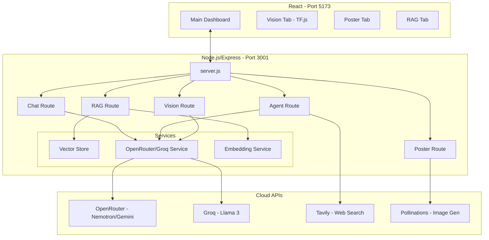

# 🧠 AI Assistant - Technical Interview Guide

This document provides a deep dive into the architecture, features, and technical decisions of the AI Assistant. Use this to explain your project to interviewers.

---

## 🏗️ System Architecture

The application follows a **Decoupled Full-Stack Architecture** with a React frontend and an Express.js backend.

---

## 🚀 Feature Breakdown & Tech Stack

### 1. Smart Chat (LLM)
*   **Model**: `nvidia/nemotron-4-340b-instruct` (via OpenRouter).
*   **Engine**: Groq (for lightning-fast inference).
*   **Tech**: Server-Sent Events (SSE) for real-time streaming.
*   **Key File**: `backend/routes/chat.js`, `backend/services/llmService.js`.

### 2. Document Intelligence (RAG)
*   **Libraries**: `pdf-parse` (Ingestion), `VectorStore.js` (Custom implementation).
*   **Embeddings**: `text-embedding-3-small` (OpenRouter).
*   **Logic**: PDF text extraction -> Chunking -> Vectorization -> Cosine Similarity Search -> Contextual Prompting.
*   **Key File**: `backend/routes/rag.js`, `backend/services/vectorStore.js`.

### 3. AI Research Agent (ReAct)
*   **Pattern**: **ReAct** (Reasoning + Acting).
*   **Tools**: Custom Calculator, Tavily Web Search API.
*   **Logic**: Thought -> Action -> Observation loop.
*   **Key File**: `backend/routes/agent.js`.

### 4. Dual-Layer Vision
*   **Local Layer**: `TensorFlow.js` with `COCO-SSD` model (Real-time object detection).
*   **Cloud Layer**: `GPT-4o-mini` (Multimodal analysis/description).
*   **Key File**: `frontend/src/components/VisionTab.jsx`, `backend/routes/vision.js`.

### 5. Poster Maker (Image Generation)
*   **Model**: `Flux.1` (via Pollinations API).
*   **Architecture**: Backend Proxy (to bypass CORS and improve reliability).
*   **Key File**: `backend/routes/poster.js`.

---

## 👨‍💻 Code Communication Flow
1.  **Frontend** sends a request (JSON or Multipart for files) to the Express Backend.
2.  **Express Middleware** (`cors`, `morgan`, `express.json`) processes the request.
3.  **Routes** handle specific logic (e.g., triggering the Agent loop or searching the Vector Store).
4.  **Services** interact with Cloud APIs (OpenRouter, Tavily) or local files (`.store.json`).
5.  **Streaming Answers** are sent back via SSE, while static data (Vision/Posters) is sent via JSON.

---

## ❓ Potential Interview Questions

### 1. "Why did you choose a custom Vector Store instead of a DB like Pinecone?"
**Answer**: "For this project, I prioritized speed and zero-dependency portability. By building a custom JSON-based vector store using Cosine Similarity, I could demonstrate my understanding of how vector search works under the hood without the overhead of an external managed database."

### 2. "How did you handle the 'Infinite Loop' problem in your AI Agent?"
**Answer**: "I implemented a `MAX_ITERATIONS` limit (set to 2) and designed the System Prompt to force the agent to provide its best guess if tools fail. I also used a non-streaming 'Thought' process to ensure the reasoning is complete before taking action."

### 3. "How does the Vision component handle privacy and performance?"
**Answer**: "I used a two-tier approach. Real-time object detection happens locally in the user's browser using TensorFlow.js, so no video data leaves the device. Only when the user clicks 'Analyze Frame' is a single snapshot sent to the backend for AI analysis."

### 4. "What was the biggest challenge you faced during development?"
**Answer**: "Handling large payloads for the Vision snapshot. I had to increase the Express JSON limit to 10MB and implement a backend proxy for the image generation to bypass CORS and network restrictions in certain environments."

### 5. "Why did you migrate from Local LLMs (Ollama) to Cloud APIs?"
**Answer**: "While local LLMs are great for privacy, they are hardware-intensive. By migrating to OpenRouter and Groq, I achieved **sub-second response times** and enabled the app to run on any device, regardless of its GPU power."
